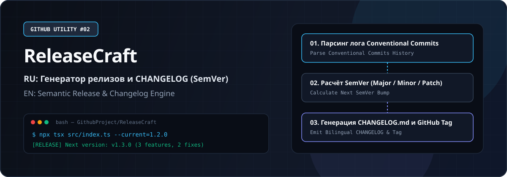
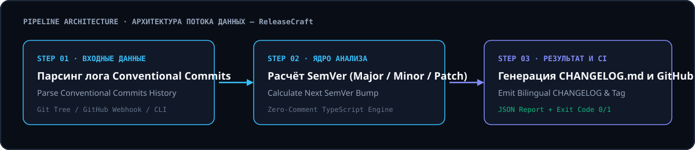

# 02. ReleaseCraft — Генератор семантических версий (SemVer) и двуязычных Changelog / Automated Semantic Versioning & Bilingual Changelog Generator



**Язык документации / Documentation Language:** [🇷🇺 Русский](#-русская-документация) · [🇬🇧 English](#-english-documentation)

---

## 🇷🇺 Русская документация

### О программе
Анализирует историю коммитов (feat, fix, perf, BREAKING CHANGE), автоматически вычисляет следующую версию по стандарту SemVer и формирует готовый CHANGELOG.md на русском и английском языках.

**Зачем нужна эта программа:** Избавляет от ручного сбора списка изменений перед каждым релизом и исключает ошибки при выборе номера версии.

### Ключевые возможности
- Автоматический расчёт версии MAJOR / MINOR / PATCH по коммитам
- Группировка изменений по категориям: Новые функции, Исправления, Производительность
- Формирование ссылок на коммиты и авторов для GitHub Releases
- Готовый вывод Markdown для мгновенной вставки в CHANGELOG.md

### Архитектура и схема работы



### Как это работает (пошагово)
1. Запустите npx tsx src/index.ts --current=1.4.2 в папке вашего репозитория.
2. Утилита считает последние коммиты из git log, классифицирует их по префиксам Conventional Commits и определяет тип обновления версии.
3. На выходе создаётся готовый блок для CHANGELOG.md и JSON-метаданные для автоматического создания GitHub Release.

### Быстрый старт (Установка и запуск)
```bash
cd GithubProject/02-ReleaseCraft
npm install
npx tsx src/index.ts --current=1.2.0 --write-changelog
```

### Параметры командной строки (CLI)
| Флаг | Описание | По умолчанию |
| :--- | :--- | :--- |
| `--current` | Текущая версия пакета (например, 1.2.0) | `1.0.0` |
| `--lang` | Язык генерации релиз-ноутов (ru | en | both) | `both` |

---

## 🇬🇧 English Documentation

### Overview
Parses Conventional Commits history, computes the next Semantic Version bump (major, minor, patch), and generates structured Markdown release notes in both Russian and English.

**Why you need it:** Eliminates manual release note compilation before tags and guarantees consistent Semantic Versioning across releases.

### Key Features
- Automatic MAJOR / MINOR / PATCH version calculation from commit headers
- Categorized sections: Features, Bug Fixes, Performance, Breaking Changes
- Commit hash and contributor attribution formatting for GitHub Releases
- Ready-to-publish Markdown output for CHANGELOG.md and GitHub Release body

### How It Works (Step-by-Step)
1. Run npx tsx src/index.ts --current=1.4.2 inside your repository.
2. The tool reads recent git log entries, classifies prefixes according to Conventional Commits, and determines the SemVer bump level.
3. Outputs a formatted CHANGELOG.md section and release metadata ready for GitHub Releases.

### Quick Start (Installation & Usage)
```bash
cd GithubProject/02-ReleaseCraft
npm install
npx tsx src/index.ts --current=1.2.0 --write-changelog
```

### CLI Options
| Flag | Description | Default |
| :--- | :--- | :--- |
| `--current` | Current semantic version string (e.g. 1.2.0) | `1.0.0` |
| `--lang` | Release notes language mode (ru | en | both) | `both` |

### GitHub Actions Integration (`.github/workflows/main.yml`)
```yaml
name: ReleaseCraft Changelog Builder
on:
  push:
    branches: [main, master]
  pull_request:
    branches: [main, master]
jobs:
  run-utility:
    runs-on: ubuntu-latest
    steps:
      - name: Checkout repository
        uses: actions/checkout@v4
      - name: Setup Node.js
        uses: actions/setup-node@v4
        with:
          node-version: 20
      - name: Execute ReleaseCraft Changelog Builder
        run: npx tsx src/index.ts 1.2.0
```

---

### Стандарты кода / Code Standards
- **0 комментариев в коде / Zero Code Comments:** Весь исходный код (`src/index.ts`) написан в самодокументируемом стиле строго без комментариев (`//` или `/* */`). / All source code is strictly self-documenting with zero comments.